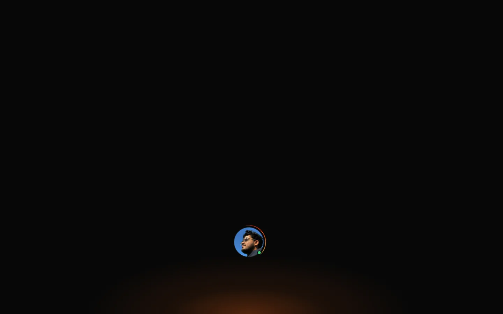
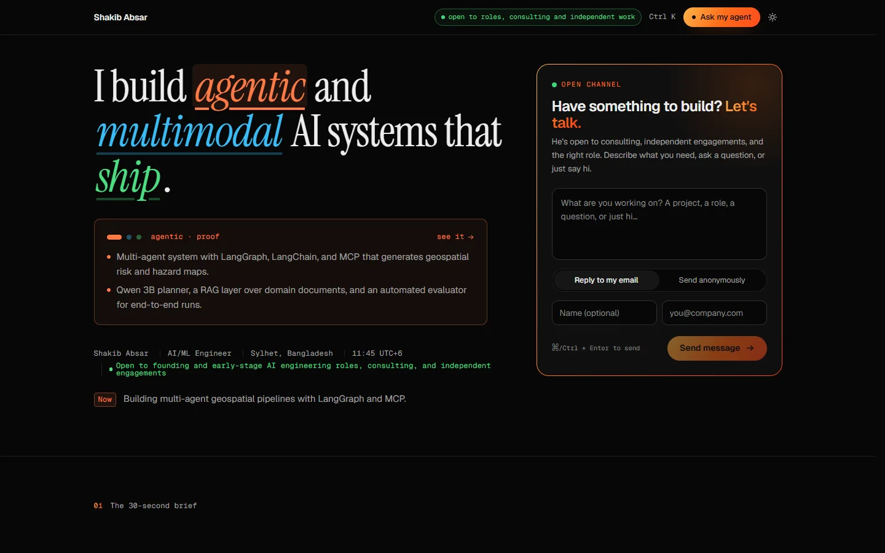
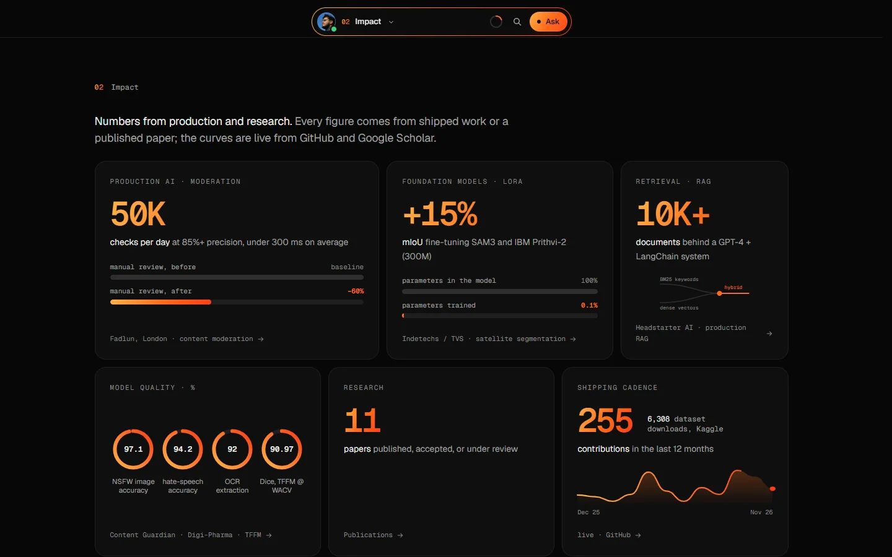
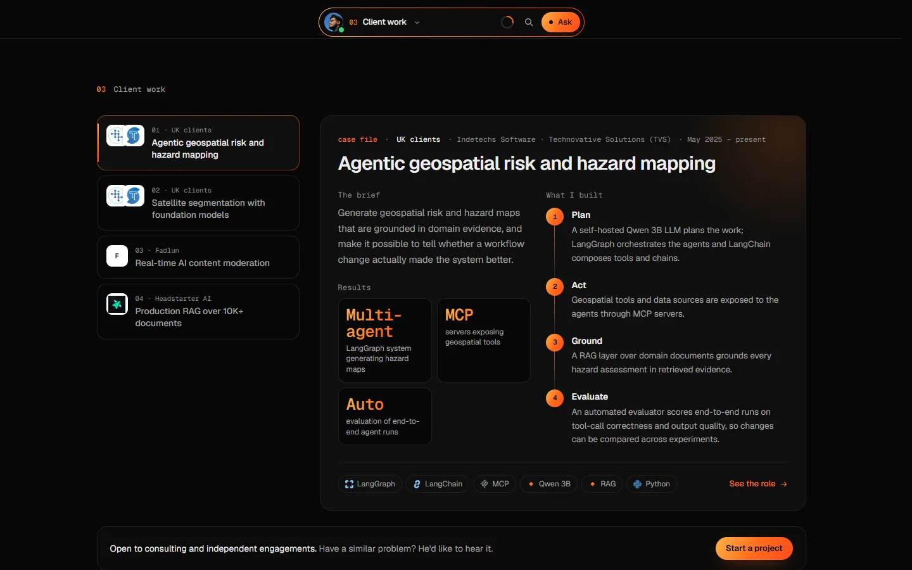
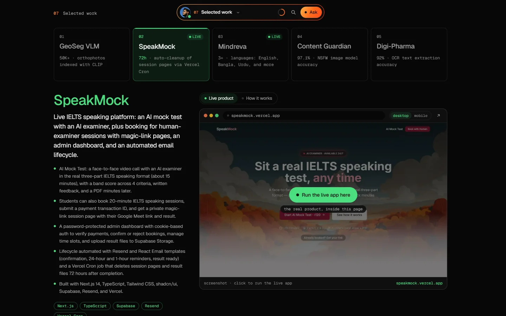
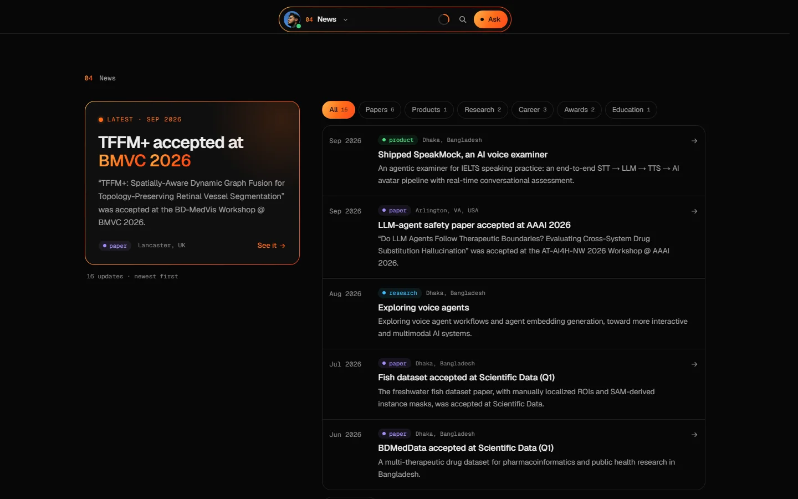
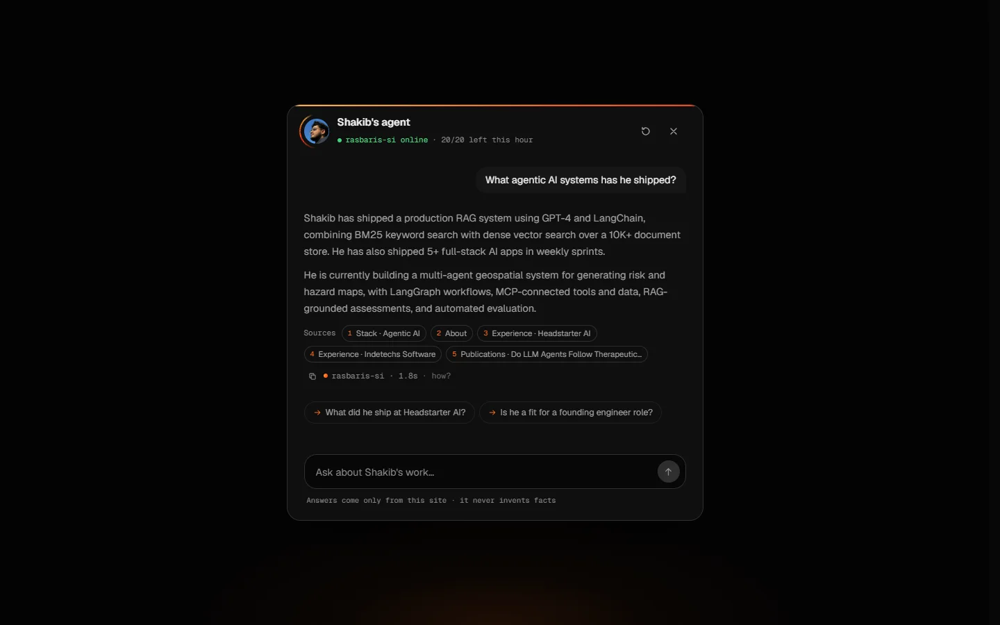
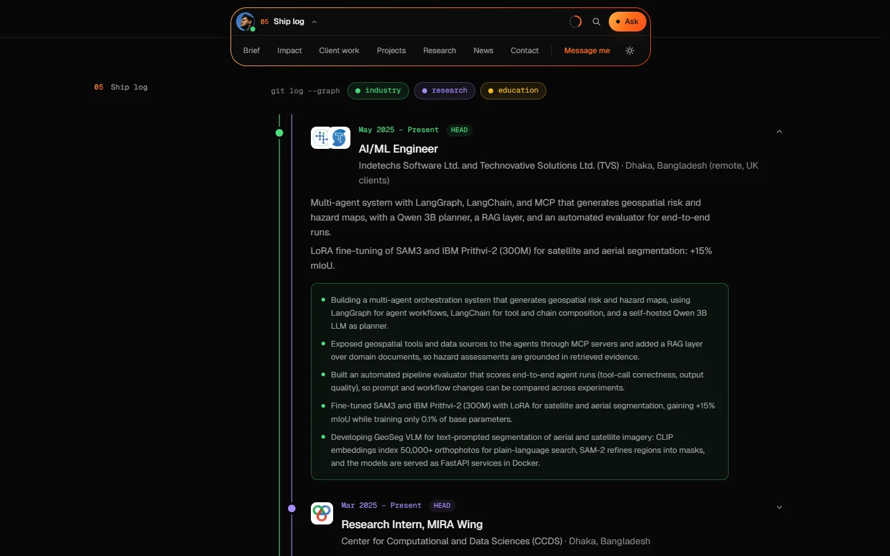

# Shakib Absar

**I build agentic and multimodal AI systems that ship.**

AI/ML Engineer · Researcher · Software Developer — Sylhet, Bangladesh (UTC+6)

 

The empty hero is intentional: one photo, one hidden door to an AI agent. Scroll, and the work speaks.

 

## Open to

**Founding and early-stage AI engineering roles, consulting, and independent engagements.**

If you're building something that needs agents, vision, or a retrieval system that holds up in production, I'd like to hear about it.
Write to **[sabsar42@gmail.com](mailto:sabsar42@gmail.com)**, or use the message form on **[sabsar42.github.io](https://sabsar42.github.io)** (you can even send it anonymously).

---

## Impact, in numbers

Every figure below comes from shipped work or a published paper.

| | |
|---|---|
| **50K** checks per day | AI content moderation in production, **85%+ precision**, under **300 ms** average response |
| **−60%** manual review | Human-in-the-loop queue routes only low-confidence cases to moderators |
| **+15% mIoU** | LoRA fine-tuning of SAM3 and IBM Prithvi-2 (300M) for satellite segmentation, training only **0.1%** of parameters |
| **10K+ documents** | Production RAG with GPT-4 and LangChain, hybrid keyword (BM25) and dense retrieval |
| **97.1% · 94.2% · 92% · 90.97%** | NSFW image model · hate-speech model · prescription OCR · Dice score for TFFM at WACV |
| **11 papers** | Published, accepted, or under review |

---

## What I build

- **Agentic systems.** Multi-agent workflows with LangGraph, LangChain, and MCP, grounded with RAG and checked by automated evaluation, so changes can be compared instead of guessed at.
- **Vision and multimodal AI.** Foundation-model adaptation (SAM, Prithvi, CLIP), vision-language search, segmentation, and medical imaging.
- **Products, end to end.** FastAPI and Docker backends through Next.js and Flutter front ends, shipped for real users.

---

## Client work

Four case files, each with the brief, what was built, and the measured result.

| Case | For | What was built | Result |
|---|---|---|---|
| **Agentic geospatial risk and hazard mapping** | UK clients, via Indetechs · TVS | A LangGraph multi-agent system with a self-hosted Qwen 3B planner, MCP-exposed geospatial tools, a RAG layer over domain documents, and an automated evaluator for end-to-end runs | Hazard assessments grounded in retrieved evidence; every workflow change measurable |
| **Satellite segmentation with foundation models** | UK clients, via Indetechs · TVS | LoRA fine-tuning of SAM3 and Prithvi-2, plus **GeoSeg VLM**: CLIP-indexed orthophotos, SAM-2 masks, served as FastAPI services in Docker | **+15% mIoU**, 0.1% of parameters trained, **50,000+** orthophotos searchable in plain language |
| **Real-time AI content moderation** | Fadlun, London | Text and image moderation for hate speech, harassment, and NSFW content, with a human-in-the-loop queue and retraining loop | **50K checks/day**, **−60%** manual review, 85%+ precision, < 300 ms |
| **Production RAG** | Headstarter AI, New York | GPT-4 + LangChain over a 10K+ document store with hybrid retrieval; 5+ full-stack AI apps shipped in weekly sprints | **10K+** documents; hackathon finalist, top 5% of 200+ teams |

---

## Selected work

| Project | What it is | Links |
|---|---|---|
| **SpeakMock** | Live IELTS speaking platform: an AI mock test with an AI examiner (about 15 minutes, band score on 4 criteria, written feedback), plus booking for human-examiner sessions with magic-link pages and an admin dashboard | [Live](https://speakmock.vercel.app) · [Code](https://github.com/sabsar42/SpeakMock) |
| **Mindreva** | Voice journaling in English, Bangla, and Urdu: talk it out and it becomes a readable journal entry | [Live](https://mindreva-web.vercel.app) · [Code](https://github.com/sabsar42/mindreva) |
| **GeoSeg VLM** | Text-prompted segmentation of aerial and satellite imagery: CLIP finds regions in plain language, SAM-2 turns them into masks | Built at Indetechs / TVS |
| **Content Guardian** | Multimodal moderation app: BERT hate-speech detection at **94.2%** and an adversarially trained NSFW image model at **97.1%** | [Code](https://github.com/sabsar42/content_safeguard) · [Demo](https://www.youtube.com/watch?v=YzBwc_2c2Eg) |
| **Digi-Pharma** | Reads prescriptions with OCR at **92%** extraction accuracy, then structures them with Gemini and a medical knowledge graph | [Code](https://github.com/sabsar42/digital_pharmacist_v2) |

---

## Research

Research in vision-language models, medical imaging, and agent safety, with datasets released openly.

- **TFFM**: Topology-Aware Feature Fusion Module via Latent Graph Reasoning for Retinal Vessel Segmentation. *WACV 2026 Workshops (P2P-CV), oral.* [Project](https://tffm-module.github.io/)
- **TFFM+**: Spatially-Aware Dynamic Graph Fusion for Topology-Preserving Retinal Vessel Segmentation. *BD-MedVis Workshop @ BMVC 2026, accepted.*
- **A Freshwater Fish Dataset for Visual Recognition** with manually localized ROIs and SAM-derived instance masks. *Scientific Data, 2026.* [Paper](https://www.nature.com/articles/s41597-026-07552-1)
- **ViT-SAGE Hybrid**: Transformer patch embeddings with graph neural network aggregation for kidney CT classification. *IEEE COMPAS 2025.* [Paper](https://ieeexplore.ieee.org/document/11381879)
- **Do LLM Agents Follow Therapeutic Boundaries?** Evaluating cross-system drug substitution hallucination. *AAAI 2026 Workshop, accepted.*

Plus the BDMedData dataset (*Scientific Data*, accepted), U-Net variants for orthopantomogram segmentation (*IEEE BECITHCON 2025*), and an explainable ensemble for kidney disease diagnosis (*AAIML 2025*). Full list on [Google Scholar](https://scholar.google.com/citations?user=30nhEaIAAAAJ).

---

## Experience

| When | Role | Where |
|---|---|---|
| May 2025 – present | **AI/ML Engineer** | Indetechs Software · Technovative Solutions (TVS), remote for UK clients |
| Mar 2025 – present | **Research Intern**, MIRA Wing | Center for Computational and Data Sciences (CCDS), Dhaka |
| Sep 2023 – present | **Research Assistant** | InteX Research Lab, Sylhet |
| Nov 2024 – Mar 2025 | **Software Developer Intern (AI)** | Fadlun, London (remote) |
| Jul – Sep 2024 | **AI Engineering Fellow** | Headstarter AI, New York (remote) |

**Education:** B.Sc. in Computer Science and Engineering, Leading University, Sylhet, 2021–2025. CGPA **3.90 / 4.00**. Thesis: ViT-SAGE Hybrid for kidney CT classification (IEEE COMPAS 2025).

---

## Recognition

- **IEEEXtreme 18.0 (2024):** 9th in Bangladesh, 1,282nd globally among 10,000+ teams
- **NASA Space Apps Challenge 2024:** Global Nominee (team ORBITUS), top 947 of 9,900+ teams
- **Collaborative AI Hackathon by SJ Innovation (2024):** 2nd Runner-Up
- **Headstarter AI Hiring Hackathon (2024):** Finalist, top 5% of 200+ teams
- **Leading University ACM:** Coder of the Month (2023), 1,000+ competitive programming problems solved
- **Chairperson**, IEEE Computer Society LU Student Branch (2024–2025)

---

## Stack

| | |
|---|---|
| **Agentic AI** | LangGraph · LangChain · MCP · multi-agent systems · RAG · agent evaluation · vector databases |
| **Vision and multimodal** | VLMs · CLIP · DINO · SAM3 · SAM-2 · Vision Transformers · OCR |
| **Machine learning** | PyTorch · TensorFlow · Hugging Face Transformers · scikit-learn · OpenCV · LoRA / QLoRA · PEFT · explainable AI |
| **Backend and deployment** | Python · TypeScript · FastAPI · Node.js · Next.js · Supabase · Docker · Vercel |

---

## Meet the site's agent

My site has its own AI agent, **rasbaris-si**. Ask it about my work and it answers only from what's on the site, shows exactly which parts it used, and says so when it doesn't know. If it ever goes offline, a built-in native agent takes over.

<table>
<tr>
<td width="50%"></td>
<td width="50%"></td>
</tr>
<tr>
<td align="center">Click my photo on the site to open it.</td>
<td align="center">Press <kbd>Ctrl</kbd>/<kbd>⌘</kbd> + <kbd>K</kbd> anywhere to jump around.</td>
</tr>
</table>

---

### Let's build something that ships.

**[sabsar42@gmail.com](mailto:sabsar42@gmail.com)** · **[sabsar42.github.io](https://sabsar42.github.io)**

Developer notes live in [docs/DEVELOPMENT.md](docs/DEVELOPMENT.md).

